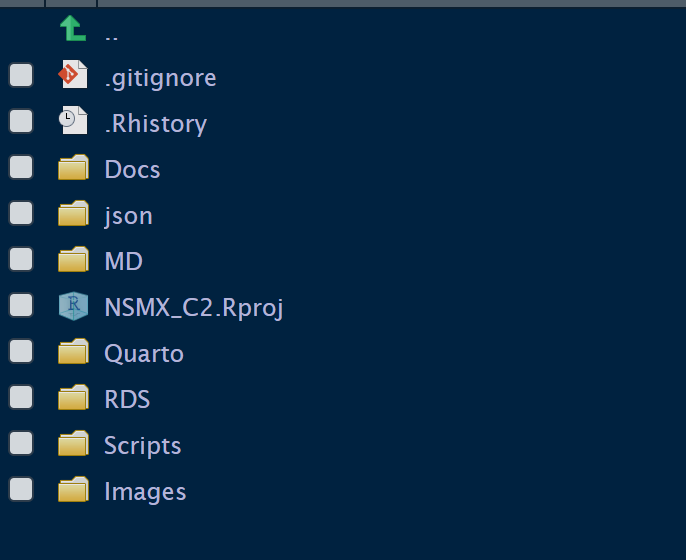

## Entorno de cómputo

### Herramientas

-   **IDE:** Posit Cloud
-   **Lenguaje:** R, con marco de trabajo tidyverse
-   **Visualización:** `ggplot2` (gráficos), `gt` (tablas)
-   **Formato de salida:** HTML y Word, renderizado desde Quarto, en Posit Cloud

### Paquetes principales

``` r
pacman::p_load(
  httr, jsonlite, forcats, zoo, tidyverse, readxl,
  here, janitor, stringr, gt, glue
)
```

### Estructura de directorios en Rstudio

{width="40%"}

### Flujo de trabajo

Todas las bases de datos se generan mediante Scripts, que se almacenan en la carpeta Scripts.

Los datos mismos se guardan en formato .rds, y se almacenan en la carpeta RDS.

Los documentos con el análisis de la información (el texto del capítulo 2), este Plan, y algunas notas que resumen nuestro aprendizaje sobre las API de las distintas fuentes de datos que usamos en este documento se encuentran en la carpeta Quarto.

Las demás carpetas están inactivas, y su contenido, en los casos que sea relevante, se traspasarán a otras carpetas.

## Contexto del capítulo

La Escuela de Gobierno y Transformación Pública del TEC de Monterrey está preparando una publicación *flagship* sobre nearshoring en México. El Capítulo 2, titulado **"Nearshoring en los datos"**, tiene como objetivo principal la construcción, descripción y visualización de las estadísticas relevantes. Aunque el énfasis es en estadística descriptiva, se incluirá un recuadro con los resultados de los estudios econométricos disponibles (ver Recuadro 1).

**Índice general de la publicación:**

1.  Introducción al NS en México
2.  NS: evidencia estadística y econométrica ← *este capítulo*
3.  Perspectivas del sector privado (estudios de casos)
4.  Agua y NS
5.  Energía y NS
6.  Sector de semiconductores
7.  Crecimiento verde
8.  IED China en México

### Índice del capítulo

1.  Introducción
2.  Importaciones EUA por país de origen, 2010-2025 y subperíodos
3.  Importaciones EUA provenientes de México
-   3.1 Por Sección del SA
-   3.2 Por Capítulo del SA, principales secciones
-   3.3 Por Partida del SA, principales capítulos
-   3.4 Por entidad federativa y sector (SCIAN)
-   3.5 Evidencia econométrica
4.  IED en México
-   4.1 Total: volumen y porcentaje del PIB
-   4.2 Por país de origen
-   4.3 Por sectores (SCIAN)
-   4.4 Distribución regional (inferencia, a partir de Censos)
-   4.5 Anuncios de inversión
-   4.6 Demanda de suelo industrial
5. Empleo IMMEX
-   5.1 Por entidad federativa
-   5.2 Por sector (SCIAN)
6. Resumen y conclusiones

### Fuentes de información

Ver Fuentes_API_tips.qmd en la carpeta Quarto

